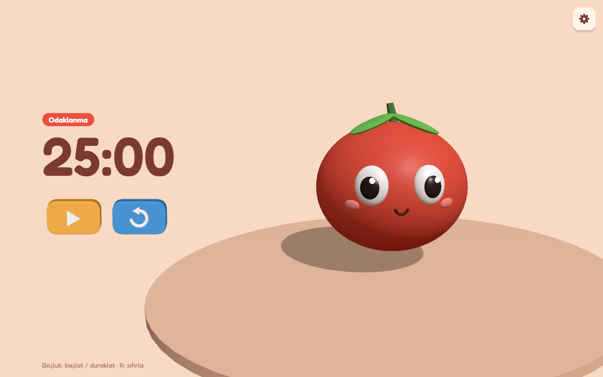

# Pomodoro 3D 🍅

Ana karakteri sevimli bir 3D domates olan, tarayıcıda çalışan bir Pomodoro zamanlayıcısı.

**▶ Canlı dene: [zeynep-kara.github.io/pomodoro-3d](https://zeynep-kara.github.io/pomodoro-3d/)**

*Pomodoro* İtalyancada "domates" demek. Teknik, adını mutfaktaki domates şeklindeki zamanlayıcılardan alıyor. Bu projede o domates, ekranın ortasında bir kaidenin üstünde duran, iri gözlü küçük bir karaktere dönüşüyor.



## Özellikler

- **3D domates karakteri:** İri parlak gözler, pembe yanaklar, gülümseme, sap ve yapraklar. Hafifçe nefes alıyor ve sağa sola salınıyor.
- **Pomodoro zamanlayıcısı:** Varsayılan olarak 25 dakika odaklanma, 5 dakika mola.
- **Ayarlanabilir süreler:** Sağ üstteki ayarlar butonundan çalışma ve mola süresi dakika olarak (1–180) girilebilir. Ayarlar tarayıcıda saklanır, sayfa yenilense de kaybolmaz.
- **Otomatik mola:** Odaklanma bitince mola kendiliğinden başlar. Mola bitince zamanlayıcı yeni tur için bekler.
- **Basılabilen 3D tuşlar:** Duraklat / devam et (▶ / ⏸) ve sıfırla (↺). Üstüne gelince büyür, basınca içeri gömülür.
- **Durum etiketi:** O an ne olduğunu gösterir: *Odaklanma*, *Duraklatıldı* ya da *Mola*.
- **Kaymayan süre:** Kalan süre gerçek saatten hesaplanır. Sekme arka planda kalsa ya da bilgisayar uyusa bile süre şaşmaz.
- **Sekme başlığında süre:** Başka bir sekmedeyken de kalan süreyi görebilirsin (ör. `24:59 · Odaklanma`).
- **Klavye kısayolları:** `Boşluk` başlat / duraklat, `R` sıfırla.
- **Mobil uyumlu:** Geniş ekranda süre solda, sahne sağda durur. Telefonda her şey alt alta dizilir ve sahne ekrana sığacak şekilde ayarlanır.

## Teknolojiler

- [React](https://react.dev) 19: arayüz ve zamanlayıcı durumu
- [three.js](https://threejs.org) 0.186: 3D sahne, karakter ve butonlar
- [Vite](https://vite.dev) 8: geliştirme sunucusu ve derleme

## Kurulum

Gereken tek şey güncel bir [Node.js](https://nodejs.org) LTS sürümü.

```bash
npm install
npm run dev
```

Terminalde çıkan adresi (genelde `http://localhost:5173/pomodoro-3d/`) tarayıcıda aç.

Yayına hazır derleme için:

```bash
npm run build
```

`main` dalına yapılan her push, [GitHub Actions](.github/workflows/deploy.yml) ile siteyi otomatik olarak derleyip GitHub Pages'te yayınlar.

> **Windows PowerShell notu:** `npm` komutu "running scripts is disabled" hatası verirse `npm` yerine `npm.cmd` yaz (`npm.cmd install`, `npm.cmd run dev`).

## Proje yapısı

```
src/
├── App.jsx                  # Sayfa düzeni, süre yazısı, klavye kısayolları
├── Scene.jsx                # Ana 3D sahneyi sayfaya yerleştirir
├── Controls.jsx             # 3D butonları süre yazısının altına yerleştirir
├── Settings.jsx             # Sağ üstteki ayarlar butonu ve paneli
├── style.css
├── pomodoro/
│   └── usePomodoro.js       # Zamanlayıcı mantığı (3D'den bağımsız)
└── 3dComponent/             # three.js kodu (React'ten bağımsız)
    ├── colors.js            # Sahnedeki tüm renkler
    ├── world/               # Ortam: kamera, renderer, ışıklar, tıklama, sahneler
    └── objects/             # Domates, kaide ve buttons/ altında 3D tuşlar
```

React ve three.js birbirinden ayrı tutuluyor. React sadece boş bir `<div>` veriyor, three.js kendi `<canvas>`'ını onun içine kurup çiziyor. Zamanlayıcı ise ikisinden de habersiz.

## Dersler

Bu proje three.js öğrenirken adım adım yazıldı. Her adımın anlatımı, deneme görevleri ve soruları [docs/base](docs/base/README.md) klasöründe.
